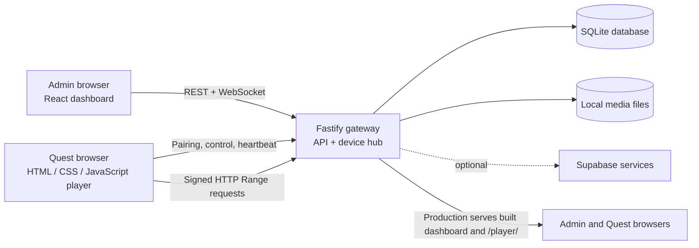

# VR Control Center

A local-first dashboard and browser player for managing Meta Quest headsets and playing video from a PC on the same LAN. The PC runs the API gateway, admin dashboard, WebSocket service, SQLite database, and media library. Headsets use Meta Quest Browser; no APK, sideloading, paid cloud service, or Meta enterprise account is required for local use.

The repository is currently documented and set up for operating two Quest 2 headsets. The gateway manages devices independently, so each paired headset has its own identity, connection, and playback state.

## Features

- Local administrator accounts with role-based access, hashed passwords, cookie sessions, and CSRF protection.
- Pairing through single-use, expiring six-digit codes; headset credentials persist in that browser until unpaired or browser storage is cleared.
- Independent per-headset load, play, pause, stop, seek, volume, status, and preview controls.
- Scheduled group playback with per-headset readiness checks and best-effort LAN synchronization.
- Video upload and direct browser streaming with HTTP byte-range requests.
- Flat, 180-degree, and 360-degree video, including side-by-side and over-under stereo layouts.
- WebXR immersive playback when the player is opened in a secure context (HTTPS or localhost).
- Playback sessions, device state, settings, and administrative audit history.
- Optional Supabase integration for deployments configured with the required project credentials and server-side role verification.

## How the system works



The Quest player is served by the gateway at `/player/`. It connects to the same gateway over HTTP(S) and WebSocket. After pairing, its device UUID and secret are kept in browser `localStorage`. For video, the gateway issues a time-limited signed URL; the headset streams the file from the PC rather than copying it to headset storage.

In development, Vite serves the admin dashboard on port `3000` and proxies API, WebSocket, and player requests to the gateway on port `4000`. In production, the gateway serves the built admin dashboard and Quest player from port `4000`.

### Playback request flow

1. An administrator signs in and pairs each headset separately.
2. The headset opens `/player/`, starts pairing, and displays a short-lived code. The administrator confirms the code and assigns a device name.
3. The admin dashboard sends device-specific commands to the gateway. The gateway validates the request and sends it over that headset's WebSocket connection; the player reports status and playback position back.
4. The player requests a signed media URL and streams the selected local file using HTTP range requests.
5. For group playback, the gateway loads the selected video on each target, waits for ready responses, then schedules a shared future start time. It monitors reported positions and can correct larger drift. Network and browser timing mean synchronization is best effort, not frame-perfect.

## Technology stack

| Area | Technology and role |
| --- | --- |
| Runtime and workspace | Node.js 24+, npm 10+, npm workspaces |
| Language | TypeScript 5.9 for the gateway, dashboard, shared types, and protocol packages |
| Admin dashboard | React 19, Vite 6, Tailwind CSS 4, Lucide icons |
| Gateway | Fastify 5, REST routes, `ws` WebSocket server, multipart upload, rate limiting |
| Quest player | Browser-native HTML, CSS, and JavaScript; Three.js for immersive projection; WebXR APIs |
| Data validation | Zod schemas in the shared protocol package |
| Persistence | Node `node:sqlite` database plus local media, thumbnail, temporary, and log directories |
| Optional cloud | Supabase JavaScript client for configured authentication, sync, or storage integrations |
| Media inspection | FFmpeg and FFprobe when installed; optional for upload and playback |
| Developer tooling | TypeScript, ESLint, Prettier, Vitest, Playwright dependency |

## Repository layout

```text
apps/
  admin/                 React dashboard, API client, views, and Vite configuration
  gateway/               Fastify API, WebSocket hub, auth, device, media, and playback services
  player/                Browser player served directly at /player/
packages/
  shared-types/          Domain types and DTOs shared across the workspace
  protocol/              Zod schemas and WebSocket protocol definitions
scripts/
  windows/               Windows install, start, and administrator setup helpers
  development/           Production launcher and generated-file cleanup
storage/                 Runtime database and media directories (created/used locally)
docs/                    Installation, usage, Quest, network, Supabase, and troubleshooting guides
```

The workspace build order is intentional: shared types and protocol are compiled first, then the admin app and gateway. The player is plain browser code and does not have its own npm build workspace.

## Requirements

- Windows 10 or 11 for the supplied PowerShell helper scripts.
- Node.js 24 or newer and npm 10 or newer.
- A PC and Quest headset(s) on the same Wi-Fi/LAN.
- Optional: FFmpeg and FFprobe on `PATH` for media metadata and thumbnail generation.
- Optional: a trusted TLS certificate for WebXR access from a headset.

Check the installed versions:

```powershell
node --version
npm --version
```

## Install and run on Windows

Run these commands from the repository root.

### 1. Install dependencies and build

```powershell
.\scripts\windows\install.ps1
```

The helper checks the Node version, creates `.env` from `.env.example` if needed, installs npm workspaces, and builds the shared packages, dashboard, and gateway. To install without building, use `-SkipBuild`.

The equivalent manual setup is:

```powershell
Copy-Item .env.example .env  # only if .env does not already exist
npm install
npm run build
```

### 2. Configure the gateway URL

The gateway listens on `0.0.0.0:4000` by default so devices on the LAN can connect. Set `PUBLIC_GATEWAY_URL` in `.env` to the PC address reachable from the headsets:

```dotenv
PUBLIC_GATEWAY_URL=http://<PC-LAN-IP>:4000
```

To find a PC IPv4 address in PowerShell:

```powershell
Get-NetIPAddress -AddressFamily IPv4 |
  Where-Object { $_.IPAddress -notlike '127.*' -and $_.IPAddress -notlike '169.254.*' }
```

Leaving `PUBLIC_GATEWAY_URL` blank allows startup auto-detection; setting it explicitly is more reliable on PCs with VPN or virtual network adapters. If the PC address changes, update this value and restart the gateway. The player URL is derived from it and ends in `/player/`.

The full configuration template is in [.env.example](.env.example). Common settings include:

| Variable | Purpose |
| --- | --- |
| `GATEWAY_HOST`, `GATEWAY_PORT` | Gateway bind address and port (defaults: `0.0.0.0`, `4000`) |
| `PUBLIC_GATEWAY_URL` | Base URL the headset uses to reach the gateway |
| `ADMIN_ORIGIN` | Admin Vite origin, normally `http://localhost:3000` for development |
| `EXTRA_ALLOWED_ORIGINS` | Comma-separated additional browser origins allowed by the gateway |
| `DATA_DIR`, `VIDEO_DIR`, `THUMBNAIL_DIR`, `TEMP_DIR`, `LOG_DIR` | Local persistence and working directories |
| `TLS_CERT_PATH`, `TLS_KEY_PATH` | Set both to enable HTTPS/WSS directly on the gateway |
| `FFPROBE_PATH`, `FFMPEG_PATH` | Optional media inspection and thumbnail tools |
| `SUPABASE_*`, `VITE_SUPABASE_*` | Optional cloud integration values; never expose a service-role key in browser code |

Keep `.env` and administrator credentials local; do not commit secrets. The example file lists operational timeouts, upload limits, preview settings, and optional integration variables as well.

### 3. Create a local administrator

Use the Windows helper to enter the password through a secure prompt:

```powershell
.\scripts\windows\create-admin.ps1 -Email admin@example.local -Name "VRCC Administrator"
```

The helper creates or resets the local account. Passwords must be at least 12 characters and include a letter and a number. The project does not ship a shared default password.

You can also run `npm run admin:create` and follow its prompts.

### 4. Start the application

For production-style local operation:

```powershell
.\scripts\windows\start.ps1
```

Or run `npm start`. The launcher builds first if the gateway production entry point is missing, then starts the gateway. Open the dashboard at `http://localhost:4000` on the PC. The Quest player is at `http://<PC-LAN-IP>:4000/player/`.

For development with hot reload:

```powershell
npm run dev
```

The Windows helper also supports `.\scripts\windows\start.ps1 -Dev`.

This builds the shared workspace packages, then starts the gateway watcher on port `4000` and Vite on port `3000`. Open `http://localhost:3000` for the dashboard. Stop both processes with `Ctrl+C`.

Allow Node.js through Windows Firewall on private networks (TCP port `4000`) so headsets can reach the gateway. WebXR requires HTTPS or localhost; ordinary HTTP over the LAN still supports flat playback and remote controls. See [docs/network-https.md](docs/network-https.md) for TLS and proxy setup.

### 5. Check gateway health

```powershell
Invoke-RestMethod http://localhost:4000/api/health
```

The response reports gateway and database status and indicates whether optional services such as FFmpeg and cloud integration are available.

## Operating workflow

### Pair headsets

1. Sign in to the dashboard and open **Headsets → Pair Headset**.
2. Open the displayed player URL or scan its QR code in Meta Quest Browser.
3. Tap **Start pairing** in the player. It displays a six-digit code that expires after the configured pairing TTL (three minutes by default).
4. Confirm the pending code in the dashboard and name the headset.
5. Repeat with a new code for every headset. Each headset gets its own device identity and secret.

Paired devices reconnect after a page or gateway restart. If browser storage is cleared or a device is unpaired, pair it again. See [docs/quest-setup.md](docs/quest-setup.md).

### Upload and play media

1. Upload a supported video (`.mp4`, `.m4v`, `.mov`, `.mkv`, or `.webm`) in **Video Library**.
2. Optionally set projection and stereo layout metadata. FFmpeg/FFprobe add duration, codec, and thumbnail details when available.
3. Select a video on an individual headset card and use the playback controls, or open **Group Playback**.

Files remain on the gateway PC under `VIDEO_DIR` (default `storage/videos`). Browser playback streams from the gateway. H.264 video with AAC audio in an MP4 container is the most reliable format for Quest Browser. Missing FFmpeg does not prevent upload, though metadata and thumbnails may be unavailable.

### Control one headset or a group

- A headset card targets that device only. **Pause All** and **Stop All** are explicit fleet-wide actions.
- Group Playback supports the same video on every selected headset or a different video per headset.
- The gateway sends load commands, waits for ready responses, and schedules a shared future start time. It monitors device reports and may seek to correct drift.
- Group synchronization is best effort over the LAN. Wi-Fi jitter, browser scheduling, and decoder startup prevent frame-perfect synchronization.

The dashboard also provides playback history, audit events, settings, and live snapshot preview while the player tab is connected.

## Development workflow

When changing the project, keep the shared contracts and runtime layers aligned:

1. Put transport-independent domain types and DTOs in `packages/shared-types`.
2. Define or update request and WebSocket message validation in `packages/protocol`.
3. Implement gateway behavior in `apps/gateway/src` (routes, services, persistence, or WebSocket handling as appropriate).
4. Update the dashboard API client and views in `apps/admin/src`, and update player behavior in `apps/player` when the headset workflow changes.
5. Run the relevant checks and rebuild the workspace before reviewing the change.

Useful commands from the root:

| Command | What it does |
| --- | --- |
| `npm run dev` | Build shared packages and start gateway + Vite dashboard in watch mode |
| `npm run build` | Build shared packages, admin SPA, then gateway |
| `npm start` | Build if the gateway output is missing and start production gateway |
| `npm run typecheck` | Build shared packages and type-check gateway and admin |
| `npm run lint` | Run ESLint across the repository |
| `npm run format:check` | Check formatting with Prettier |
| `npm run format` | Format repository files with Prettier |
| `npm test` | Run Vitest projects in `packages/*` and `apps/*` |
| `npm run test:watch` | Run Vitest in watch mode |
| `npm run test:coverage` | Run Vitest with V8 coverage |
| `npm run test:e2e` | Playwright runner entry point; add Playwright config and specs before relying on it |
| `npm run admin:create` | Create or reset a local administrator |
| `npm run quest:simulate` | Run the gateway's simulated Quest protocol client |
| `npm run clean` | Remove generated build and coverage output; local `storage/` is retained |

For headset behavior, use [docs/quest-setup.md](docs/quest-setup.md) as the physical-device verification checklist. Automated checks and the protocol simulator cannot replace testing on the target Quest browser, Wi-Fi network, codecs, and certificate.

## Data and security

- The gateway stores operational records in SQLite under `DATA_DIR` (default `storage/data`) and uploaded media under `VIDEO_DIR` (default `storage/videos`). Back up the database and media files together when preserving an installation.
- Admin sessions use an HttpOnly cookie and CSRF token. Local passwords are stored as password hashes, not plaintext.
- The headset's device secret is used to authenticate player requests. Media URLs are signed and expire; range streaming does not expose the device secret.
- HTTPS is optional for LAN control and flat video playback, but required by the browser for WebXR on a remote headset. Configure a certificate trusted by the headset.
- Supabase is optional. Local sign-in and SQLite-backed operation do not require Supabase. Supabase role-based admin sign-in requires server-side credentials and the configured profile-role data; see [docs/supabase.md](docs/supabase.md).

## Known limitations

- Group playback is network-coordinated best effort, not frame-accurate genlock.
- Browser players cannot report real headset free disk space.
- FFmpeg and FFprobe are optional; without them, some video metadata and thumbnails are unavailable.
- The deployment/download API is retained for a future native Quest client; browser players stream media directly.
- WebXR is unavailable from a headset over plain HTTP; use HTTPS for immersive playback.

## Further documentation

- [Installation details](docs/installation.md)
- [Dashboard user guide](docs/user-guide.md)
- [Quest setup and hardware checklist](docs/quest-setup.md)
- [Network and HTTPS](docs/network-https.md)
- [Supabase setup](docs/supabase.md)
- [Troubleshooting](docs/troubleshooting.md)
