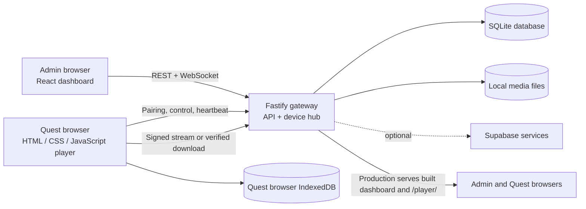
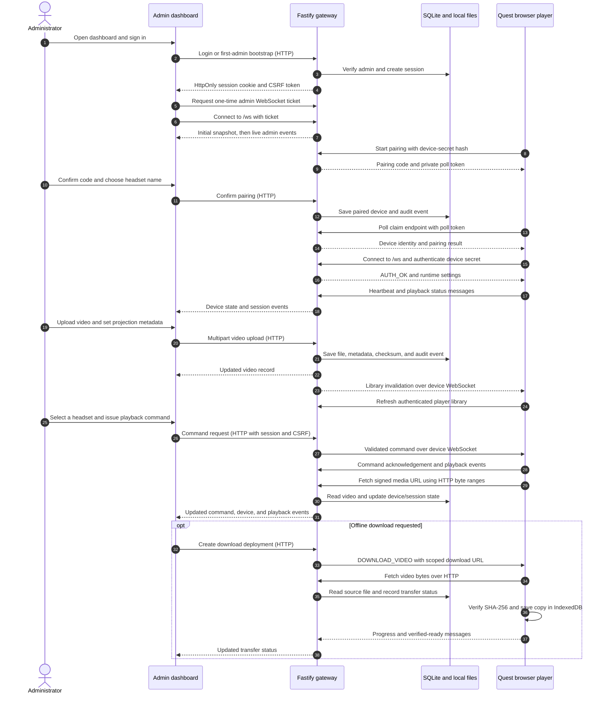

# VR Control Center

A local-first dashboard and browser player for managing Meta Quest headsets and playing video from a PC on the same LAN. The PC runs the API gateway, admin dashboard, WebSocket service, SQLite database, and media library. Headsets use Meta Quest Browser; no APK, sideloading, paid cloud service, or Meta enterprise account is required for local use.

The setup guide walks through a two-headset Quest 2 installation. The gateway supports independently paired headsets, each with its own identity, connection, and playback state.

## Features

- Local administrator accounts with role-based access, hashed passwords, cookie sessions, and CSRF protection.
- Pairing through single-use, expiring six-digit codes; headset credentials persist in that browser until unpaired or browser storage is cleared.
- Independent per-headset load, play, pause, stop, seek, volume, status, and preview controls.
- Scheduled group playback with per-headset readiness checks and best-effort LAN synchronization; direct control releases a headset from group drift correction.
- Video upload and browser streaming, plus checksum-verified offline downloads for Quest browser players with transfer progress in the dashboard.
- Connected headset libraries refresh after videos are added, changed, or removed; the player also refreshes on reconnect, resume, and a periodic safety check.
- Flat, 180-degree, and 360-degree video, including side-by-side and over-under stereo layouts.
- WebXR immersive playback when the player is opened in a secure context (HTTPS or localhost), with in-view controls where DOM overlay is supported.
- Playback sessions, device state, configurable snapshot preview cadence, settings, and administrative audit history.
- Dashboard session state is cleared when the gateway rejects an expired session, and headset command failures are shown on the affected device card.
- Optional Supabase integration for deployments configured with the required project credentials and server-side role verification.

## How the system works



The Quest player is served by the gateway at `/player/`. When Meta Quest Browser opens the gateway root (`/` or `/index.html`), the gateway redirects it to `/player/`; other browsers continue to reach the admin dashboard. The player connects to the same gateway over HTTP(S) and WebSocket. After pairing, its device UUID and secret are kept in browser `localStorage`. Online playback streams from the PC through a time-limited signed URL. **Send to Headsets** saves a separate, checksum-verified copy in IndexedDB under the Quest browser's local site storage for offline playback.

In development, Vite serves the admin dashboard on port `3000` and proxies API, WebSocket, and player requests to the gateway on port `4000`. In production, the gateway serves the built admin dashboard and Quest player from port `4000`.

### End-to-end application flow

This sequence shows the main path through the dashboard, gateway, Quest player, database, and local media library. Commands and status use WebSockets; video bytes use separate HTTP requests.



#### 1. Build and start the gateway

The root npm workspace builds `shared-types` and `protocol` first, then the React dashboard and TypeScript gateway. The browser player is static HTML, CSS, and JavaScript under `apps/player`. At startup, the gateway loads `.env`, creates configured data and media directories, opens the SQLite store, detects optional FFmpeg tools, creates the auth/device/playback/media services, and starts HTTP and WebSocket listeners. Production serves the built dashboard and `/player/` from the gateway; development uses Vite on port `3000` and proxies requests to the gateway on port `4000`.

If the database has no administrator, the gateway generates a one-time setup token and writes it under `DATA_DIR` while also printing it to the console. The first administrator can be created through the setup screen or `npm run admin:create`; the project has no shared default password. Later administrators sign in with a local password or, when configured, Supabase authentication with a server-verified role.

#### 2. Authenticate the dashboard and load live state

Successful sign-in creates a server-side session. The browser receives an HttpOnly session cookie and a CSRF token; state-changing REST requests send both. The dashboard requests a short-lived, single-use WebSocket ticket and connects to `/ws` as an administrator. The gateway immediately sends a snapshot containing devices, videos, active transfers, pairing requests, recent commands, playback group state, settings, and cloud status. After that, WebSocket events keep the React views current. Dashboard commands themselves use authenticated HTTP requests; the admin socket carries state updates and previews.

#### 3. Pair and connect a Quest player

Each headset opens `/player/` and generates a device secret in its browser. It sends only the secret's SHA-256 hash to the pairing endpoint, which creates an expiring six-digit code and a separate poll token. The administrator confirms the code and assigns a name in **Headsets**. The gateway records the device and credential hash, then the player claims the result with its poll token and stores its device identity and secret in browser `localStorage`.

The paired player opens a device WebSocket and authenticates with its UUID and secret. The gateway checks the credential, registers the live connection, and sends runtime settings such as heartbeat interval and preview cap. The player then reports heartbeats, capabilities, storage estimate, video inventory, and playback state. It reconnects after network interruptions; the gateway marks devices offline when their authenticated socket or heartbeat becomes stale. Clearing browser storage or unpairing removes the saved identity, so the headset must be paired again.

#### 4. Upload and distribute library changes

An administrator uploads a supported video from **Video Library**. The gateway validates the multipart request and file type, streams the file to a temporary file while calculating SHA-256, and rejects empty, oversized, or duplicate files. If FFprobe is available, it reads duration, dimensions, frame rate, codecs, and compatibility; FFmpeg can generate a thumbnail. Without those tools, upload still works and metadata is marked unverified.

The gateway moves the source into a video-specific directory under `VIDEO_DIR`, stores its metadata in SQLite, and records an audit event. It broadcasts the updated video to connected admin dashboards and sends a lightweight library-change message to connected players. A player responds by fetching a fresh authenticated library session; it does not receive the full video file as part of that notification.

#### 5. Play from the gateway or from a local copy

For online playback, the player authenticates to `/api/player/session` and receives its available library plus time-limited signed media and thumbnail URLs. The dashboard sends commands such as load, play, pause, seek, or stop to a specific device through REST. The gateway records the command and relays it over that device's WebSocket. The player acknowledges the command and sends playback events; the gateway updates the device state and playback session in SQLite and broadcasts the change to the dashboard.

The video element fetches the signed stream URL directly over HTTP and can request byte ranges while seeking. The URL is scoped to a video and expires; the headset secret is not placed in the media request. An offline copy is optional: **Send to Headsets** creates a per-headset transfer, sends a scoped download URL through the control socket, and serves the file separately over HTTP. The player writes the download to IndexedDB, reports progress, verifies the file's SHA-256 and size, and reports success. The dashboard marks the transfer ready only after the gateway checks the reported checksum and size against the library record. The saved copy appears under **Downloads** and can play without streaming while that browser storage remains available.

#### 6. Coordinate a group start

**Group Playback** accepts one shared video or a different video for each selected online headset. The gateway validates the assignments, sends each player a load command, and waits for confirmed ready events. Once ready, it schedules a common future start timestamp; each player uses its measured clock offset to start locally. The gateway compares reported positions to the expected timeline and may seek a headset when drift exceeds 2.5 seconds, with a 10-second correction cooldown. A headset that an administrator controls directly is detached from drift correction so later group updates do not override that control. Network jitter, browser scheduling, and decoder startup make synchronization best effort rather than frame-accurate.

#### 7. Monitor, preview, and retain operational records

Headset heartbeats and status reports drive the online/offline view. The optional **Live View** snapshot preview asks a connected player to capture JPEG frames and forwards them to the dashboard at the configured cadence; this is not a WebRTC camera stream. The gateway stores device logs, commands, playback sessions, transfer state, settings, and audit history in SQLite. Uploaded videos and thumbnails live under the configured local media directories. Optional Supabase services can add server-verified sign-in and configured cloud synchronization, but local accounts, SQLite, and local media keep working without Supabase.

## Technology stack

| Area                  | Technology and role                                                                     |
| --------------------- | --------------------------------------------------------------------------------------- |
| Runtime and workspace | Node.js 24+, npm 10+, npm workspaces                                                    |
| Language              | TypeScript 5.9 for the gateway, dashboard, shared types, and protocol packages          |
| Admin dashboard       | React 19, Vite 6, Tailwind CSS 4, Lucide icons                                          |
| Gateway               | Fastify 5, REST routes, `ws` WebSocket server, multipart upload, rate limiting          |
| Quest player          | Browser-native HTML, CSS, and JavaScript; Three.js for immersive projection; WebXR APIs |
| Data validation       | Zod schemas in the shared protocol package                                              |
| Persistence           | Node `node:sqlite` database plus local media, thumbnail, temporary, and log directories |
| Optional cloud        | Supabase JavaScript client for configured authentication, sync, or storage integrations |
| Media inspection      | FFmpeg and FFprobe when installed; optional for upload and playback                     |
| Developer tooling     | TypeScript, ESLint, Prettier, Vitest, Playwright dependency                             |

## Repository layout

```text
apps/
  admin/                 React dashboard, API client, views, and Vite configuration
  gateway/               Fastify API, WebSocket hub, auth, device, media, and playback services
  player/                Browser player served directly at /player/
packages/
  shared-types/          Domain types and DTOs shared across the workspace
  protocol/              Zod schemas and WebSocket protocol definitions
scripts/
  windows/               Windows install, start, and administrator setup helpers
  development/           Production launcher and generated-file cleanup
storage/                 Runtime database and media directories (created/used locally)
docs/                    Installation, usage, Quest, network, Supabase, and troubleshooting guides
```

The workspace build order is intentional: shared types and protocol are compiled first, then the admin app and gateway. The player is plain browser code and does not have its own npm build workspace.

## Requirements

- Windows 10 or 11 for the supplied PowerShell helper scripts.
- Node.js 24 or newer and npm 10 or newer.
- A PC and Quest headset(s) on the same Wi-Fi/LAN.
- Optional: FFmpeg and FFprobe on `PATH` for media metadata and thumbnail generation.
- Optional: a trusted TLS certificate for WebXR access from a headset.

Check the installed versions:

```powershell
node --version
npm --version
```

## Install and run on Windows

Run these commands from the repository root.

### 1. Install dependencies and build

```powershell
.\scripts\windows\install.ps1
```

The helper checks the Node version, creates `.env` from `.env.example` if needed, installs npm workspaces, and builds the shared packages, dashboard, and gateway. To install without building, use `-SkipBuild`.

The equivalent manual setup is:

```powershell
Copy-Item .env.example .env  # only if .env does not already exist
npm install
npm run build
```

### 2. Configure the gateway URL

The gateway listens on `0.0.0.0:4000` by default so devices on the LAN can connect. Set `PUBLIC_GATEWAY_URL` in `.env` to the PC address reachable from the headsets:

```dotenv
PUBLIC_GATEWAY_URL=http://<PC-LAN-IP>:4000
```

To find a PC IPv4 address in PowerShell:

```powershell
Get-NetIPAddress -AddressFamily IPv4 |
  Where-Object { $_.IPAddress -notlike '127.*' -and $_.IPAddress -notlike '169.254.*' }
```

Leaving `PUBLIC_GATEWAY_URL` blank allows startup auto-detection; setting it explicitly is more reliable on PCs with VPN or virtual network adapters. If the PC address changes, update this value and restart the gateway. The player URL is derived from it and ends in `/player/`.

The full configuration template is in [.env.example](.env.example). Common settings include:

| Variable                                                        | Purpose                                                                            |
| --------------------------------------------------------------- | ---------------------------------------------------------------------------------- |
| `GATEWAY_HOST`, `GATEWAY_PORT`                                  | Gateway bind address and port (defaults: `0.0.0.0`, `4000`)                        |
| `PUBLIC_GATEWAY_URL`                                            | Base URL the headset uses to reach the gateway                                     |
| `ADMIN_ORIGIN`                                                  | Admin Vite origin, normally `http://localhost:3000` for development                |
| `EXTRA_ALLOWED_ORIGINS`                                         | Comma-separated additional browser origins allowed by the gateway                  |
| `DATA_DIR`, `VIDEO_DIR`, `THUMBNAIL_DIR`, `TEMP_DIR`, `LOG_DIR` | Local persistence and working directories                                          |
| `TLS_CERT_PATH`, `TLS_KEY_PATH`                                 | Set both to enable HTTPS/WSS directly on the gateway                               |
| `PREVIEW_MAX_FPS`                                                | Maximum headset snapshot preview cadence (5–30 FPS; default: 30)                    |
| `FFPROBE_PATH`, `FFMPEG_PATH`                                   | Optional media inspection and thumbnail tools                                      |
| `SUPABASE_*`, `VITE_SUPABASE_*`                                 | Optional cloud integration values; never expose a service-role key in browser code |

Keep `.env` and administrator credentials local; do not commit secrets. The example file lists operational timeouts, upload limits, preview settings, and optional integration variables as well.

### 3. Create a local administrator

Use the Windows helper to enter the password through a secure prompt:

```powershell
.\scripts\windows\create-admin.ps1 -Email admin@example.local -Name "VRCC Administrator"
```

The helper creates or resets the local account. Passwords must be at least 12 characters and include a letter and a number. The project does not ship a shared default password.

You can also run `npm run admin:create` and follow its prompts.

### 4. Start the application

For production-style local operation:

```powershell
.\scripts\windows\start.ps1
```

Or run `npm start`. The launcher builds first if the gateway production entry point is missing, then starts the gateway. Open the dashboard at `http://localhost:4000` on the PC. The Quest player is at `http://<PC-LAN-IP>:4000/player/`.

For development with hot reload:

```powershell
npm run dev
```

The Windows helper also supports `.\scripts\windows\start.ps1 -Dev`.

This builds the shared workspace packages, then starts the gateway watcher on port `4000` and Vite on port `3000`. Open `http://localhost:3000` for the dashboard. Stop both processes with `Ctrl+C`.

Allow Node.js through Windows Firewall on private networks (TCP port `4000`) so headsets can reach the gateway. WebXR requires HTTPS or localhost; ordinary HTTP over the LAN still supports flat playback and remote controls.

To use immersive 180/360 playback on a headset, enable the bundled local HTTPS setup:

```powershell
npm run https:setup
```

Set `TLS_CERT_PATH=./certs/gateway.crt` and `TLS_KEY_PATH=./certs/gateway.key` in `.env`, then restart the gateway. Open the new `https://<PC-LAN-IP>:4000/player/` URL on the headset, accept the certificate warning once, and pair the headset again (browser storage is per origin). See [docs/network-https.md](docs/network-https.md) for trusted-certificate and proxy options.

### 5. Check gateway health

```powershell
Invoke-RestMethod http://localhost:4000/api/health
```

The response reports gateway and database status and indicates whether optional services such as FFmpeg and cloud integration are available.

## Operating workflow

### Pair headsets

1. Sign in to the dashboard and open **Headsets → Pair Headset**.
2. Open the displayed player URL or scan its QR code in Meta Quest Browser.
3. Tap **Start pairing** in the player. It displays a six-digit code that expires after the configured pairing TTL (three minutes by default).
4. Confirm the pending code in the dashboard and name the headset.
5. Repeat with a new code for every headset. Each headset gets its own device identity and secret.

Paired devices reconnect after a page or gateway restart. If browser storage is cleared or a device is unpaired, pair it again. See [docs/quest-setup.md](docs/quest-setup.md).

### Upload and play media

1. Upload a supported video (`.mp4`, `.m4v`, `.mov`, `.mkv`, or `.webm`) in **Video Library**.
2. Optionally set projection and stereo layout metadata. FFmpeg/FFprobe add duration, codec, and thumbnail details when available.
3. Select a video on an individual headset card and use the playback controls, or open **Group Playback**. To prepare offline playback, choose **Send to Headsets**, keep the player tab open during transfer, and check progress under **Active Transfers** in the dashboard or **Downloads** in the player.

The dashboard refreshes its video list after a successful upload. The gateway also notifies connected paired players when a video is added, updated, or deleted; players refresh on that notification and when they return to the foreground. A periodic refresh provides a fallback if a notification is missed.

The source files remain on the gateway PC under `VIDEO_DIR` (default `storage/videos`); downloaded copies use the Quest browser's local site storage. H.264 video with AAC audio in an MP4 container is the most reliable format for Quest Browser. Missing FFmpeg does not prevent upload, though metadata and thumbnails may be unavailable.

### Control one headset or a group

- A headset card targets that device only. A direct playback command takes that headset out of active group drift correction. **Pause All** and **Stop All** are explicit fleet-wide actions.
- Group Playback supports the same video on every selected headset or a different video per headset.
- The gateway sends load commands, waits for ready responses, and schedules a shared future start time. It monitors device reports and may seek to correct drift.
- Group synchronization is best effort over the LAN. Wi-Fi jitter, browser scheduling, and decoder startup prevent frame-perfect synchronization.

The dashboard also provides playback history, audit events, settings, and live snapshot preview while the player tab is connected. Preview cadence is configurable in Settings; the default target is 12 FPS, subject to headset and network performance.

## Development workflow

When changing the project, keep the shared contracts and runtime layers aligned:

1. Put transport-independent domain types and DTOs in `packages/shared-types`.
2. Define or update request and WebSocket message validation in `packages/protocol`.
3. Implement gateway behavior in `apps/gateway/src` (routes, services, persistence, or WebSocket handling as appropriate).
4. Update the dashboard API client and views in `apps/admin/src`, and update player behavior in `apps/player` when the headset workflow changes.
5. Run the relevant checks and rebuild the workspace before reviewing the change.

Useful commands from the root:

| Command                  | What it does                                                                        |
| ------------------------ | ----------------------------------------------------------------------------------- |
| `npm run dev`            | Build shared packages and start gateway + Vite dashboard in watch mode              |
| `npm run build`          | Build shared packages, admin SPA, then gateway                                      |
| `npm start`              | Build if the gateway output is missing and start production gateway                 |
| `npm run typecheck`      | Build shared packages and type-check gateway and admin                              |
| `npm run lint`           | Run ESLint across the repository                                                    |
| `npm run format:check`   | Check formatting with Prettier                                                      |
| `npm run format`         | Format repository files with Prettier                                               |
| `npm test`               | Run Vitest projects in `packages/*` and `apps/*`                                    |
| `npm run test:watch`     | Run Vitest in watch mode                                                            |
| `npm run test:coverage`  | Run Vitest with V8 coverage                                                         |
| `npm run test:e2e`       | Playwright runner entry point; add Playwright config and specs before relying on it |
| `npm run admin:create`   | Create or reset a local administrator                                               |
| `npm run quest:simulate` | Run the gateway's simulated Quest protocol client                                   |
| `npm run clean`          | Remove generated build and coverage output; local `storage/` is retained            |

For headset behavior, use [docs/quest-setup.md](docs/quest-setup.md) as the physical-device verification checklist. Automated checks and the protocol simulator cannot replace testing on the target Quest browser, Wi-Fi network, codecs, and certificate.

## Data and security

- The gateway stores operational records in SQLite under `DATA_DIR` (default `storage/data`) and uploaded media under `VIDEO_DIR` (default `storage/videos`). Back up the database and media files together when preserving an installation.
- Offline video copies are stored in IndexedDB under the Quest browser's site origin and can be managed from the player's **Downloads** panel. Browser storage quota is controlled by the browser and operating system.
- Admin sessions use an HttpOnly cookie and CSRF token. Local passwords are stored as password hashes, not plaintext.
- The headset's device secret is used to authenticate player requests. Media URLs are signed and expire; range streaming does not expose the device secret.
- HTTPS is optional for LAN control and flat video playback, but required by the browser for WebXR on a remote headset. Configure a certificate trusted by the headset.
- Supabase is optional. The dashboard sign-in form uses the local administrator account, and local SQLite-backed operation does not require Supabase. The gateway's Supabase sign-in API requires server-side credentials and configured profile-role data; see [docs/supabase.md](docs/supabase.md).

## Known limitations

- Group playback is network-coordinated best effort, not frame-accurate genlock.
- Browser players report available site-storage quota, not total Quest disk capacity.
- FFmpeg and FFprobe are optional; without them, some video metadata and thumbnails are unavailable.
- Offline browser downloads require the player tab to stay open until the transfer finishes.
- WebXR is unavailable from a headset over plain HTTP; use HTTPS for immersive playback.
- If immersive WebXR does not support a DOM overlay, the controller trigger toggles playback; exit VR to seek or change volume.

## Further documentation

- [Installation details](docs/installation.md)
- [Dashboard user guide](docs/user-guide.md)
- [Quest setup and hardware checklist](docs/quest-setup.md)
- [Network and HTTPS](docs/network-https.md)
- [Supabase setup](docs/supabase.md)
- [Troubleshooting](docs/troubleshooting.md)
